<picture>
  <source media="(prefers-color-scheme: dark)" srcset="./assets/adhd-hero-dark.svg">
  
</picture>

<b>Saad Zakaria.</b> · ST Student | Robotics, Artificial Intelligence &amp; Embedded Systems | Learning by Building

#### Signal

<picture>
  <source media="(prefers-color-scheme: dark)" srcset="./assets/adhd-signal-dark.svg">
  
</picture>

Reading the signal

- **Seismograph:** one swing of the pen per day of the last 365. The bigger the swing, the busier the day.
- **Time, as experienced:** there are two times, now and not now. The bars under the clock are contributions by weekday (busiest: Sat).
- **Counters:** longest streak, contributions in the last 12 months, active days, stars, followers and years on GitHub.
- **Dopamine by source:** language share by bytes across public repositories.
- **The opening shot:** autofocus hunts through the noise, then locks on. The out-of-focus lights behind it are the last 12 months, one per month; bigger and brighter means busier.

ADHD isn’t a shortage of attention. Attention goes where interest is, and when it gets there it locks on hard. Artwork: original animated SVG, generated by README Templates · template: ADHD. Motion stops if your system asks for reduced motion.

#### Open tabs

- `TAB 01` **[Redstone-AI](https://github.com/SsaadZKR/Redstone-AI)**  
  ★ 1
- `TAB 02` **[saadlgzkrnokia-cyber](https://github.com/SsaadZKR/saadlgzkrnokia-cyber)**  

<picture>
  <source media="(prefers-color-scheme: dark)" srcset="./assets/adhd-end-dark.svg">
  
</picture>

